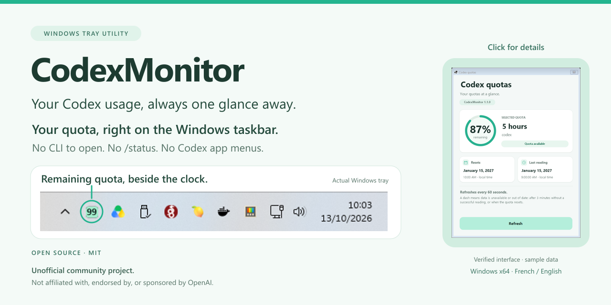
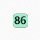
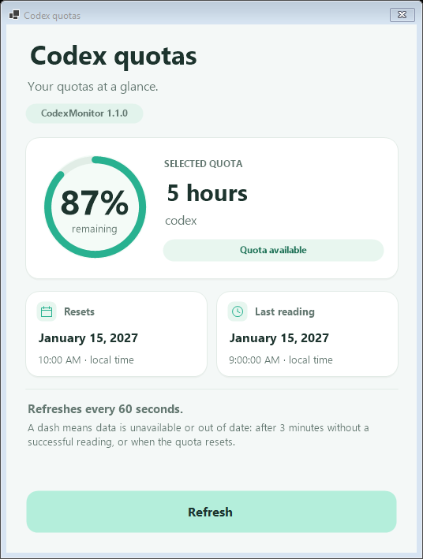
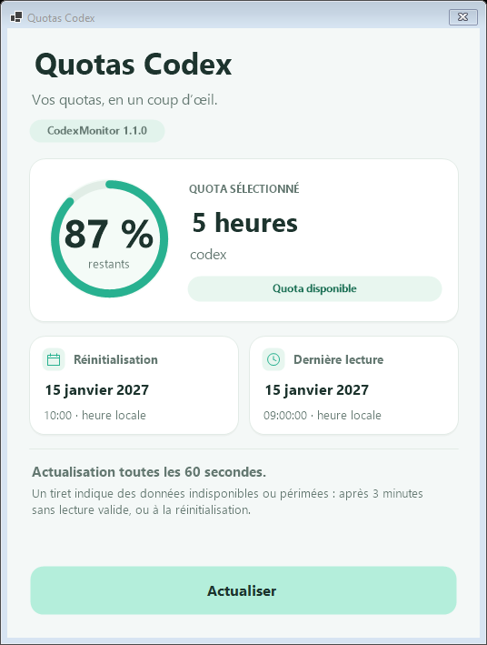

# CodexMonitor

[](https://github.com/Patrice-Gaudicheau/CodexMonitor/releases/latest)

[Download](https://github.com/Patrice-Gaudicheau/CodexMonitor/releases/latest) · [Installation Guide](docs/INSTALLATION.md) · [MIT License](LICENSE)

**Your Codex usage, always one glance away.**

CodexMonitor is a lightweight Windows tray utility for your remaining OpenAI Codex usage quota. Read the numeric badge at a glance, then click for quota details and reset times.

> **Unofficial community project. Not affiliated with, endorsed by, or sponsored by OpenAI.**

**v1.1.0** brings French and English support with instant language switching. Get the standalone Windows x64 executable from [GitHub Releases](https://github.com/Patrice-Gaudicheau/CodexMonitor/releases/latest).

## Features

- Remaining quota at a glance, with mint-green, orange, and red status colors.
- Automatic refresh about every 60 seconds, plus manual refresh.
- Choice of available quotas, including five-hour and weekly limits when supplied by your account.
- Native details window with a circular indicator, reset time, and last successful reading.
- French or English, selected automatically or through a saved manual preference in v1.1.0.
- Optional startup with Windows and protection against duplicate instances.
- Portable, self-contained executable: no installation wizard or separate .NET installation.

## Screenshots

The actual Windows notification-area badge: 

Native v1.1.0 details windows rendered during verification with sample quota data:

| English | French |
| --- | --- |
|  |  |

The mint-green design, quota indicator, and layout are shared by both languages. These verified captures use sample readings; dates and percentages are illustrative.

## Requirements

- Windows x64.
- An authenticated **native Windows Codex CLI** and an account that supplies ChatGPT quota information. A WSL-only installation is not sufficient; API-key-only accounts may not supply these percentages.
- Network access for quota retrieval.

No .NET SDK or runtime installation is needed to run the downloaded executable. Normal use does not require administrator privileges. See the [installation guide](docs/INSTALLATION.md#check-the-native-windows-codex-cli) for CLI availability and sign-in checks.

## Installation

1. Open the [latest GitHub Release](https://github.com/Patrice-Gaudicheau/CodexMonitor/releases/latest).
2. Download **CodexMonitor.exe**. Optionally download **SHA256SUMS.txt** from the same release.
3. Create a permanent folder, such as `C:\Tools\CodexMonitor`, and copy the executable there.
4. Run `CodexMonitor.exe`.
5. Find its numeric icon in the Windows notification area. If it is hidden, open the notification overflow and drag the icon into the visible area, or enable its visibility in Windows taskbar settings.

For an optional integrity check, open PowerShell in the download folder:

```powershell
Get-FileHash .\CodexMonitor.exe -Algorithm SHA256
```

Compare the hash with the entry for `CodexMonitor.exe` in **SHA256SUMS.txt from the same release**. The current release executable is unsigned, so Windows SmartScreen may display a warning. Verify the repository, release source, and checksum before trusting it; keep Windows security protections enabled. See [installation and SmartScreen guidance](docs/INSTALLATION.md).

## Quick start

- **Read the badge:** its number is the remaining percentage, without a `%` sign. Mint green means more than 50%, orange means 20–50%, and red means below 20%. A gray dash means unavailable or out-of-date data.
- **Left-click** the badge to open details. Dates and times use your local Windows timezone. Press Esc or close the window to return to the tray.
- **Right-click** for the context menu. Use **Displayed quota** to select a quota, or **Refresh now** to request a reading. The details window also has a **Refresh** button, disabled while a reading is in progress.
- Toggle **Start with Windows** to enable or disable startup at sign-in. It is disabled by default; enable it after placing the executable in its permanent folder.
- In v1.1.0, open **Langue / Language** to choose **Automatic (Windows)**, **Français**, or **English**.
- Choose **Exit** before replacing the executable or when you want to stop monitoring.

Menu labels follow the selected interface language. Available quotas depend on what Codex supplies for your account; CodexMonitor does not estimate missing limits.

## Language support — v1.1.0

Automatic mode uses the Windows **user interface language**: French variants such as `fr-FR`, `fr-CA`, `fr-BE`, and `fr-CH` select French; all other languages select English. Region, keyboard layout, and IP address do not affect this choice.

A manual choice takes effect immediately, including an open details window, menus, tooltips, accessibility descriptions, and cached warnings. It is saved for future launches. Returning to Automatic restores the Windows UI language detected at startup. Windows language settings are never changed.

Both languages are included in the same standalone executable. See [localization architecture](docs/LOCALIZATION.md).

## Updating

1. Download the newer executable from [GitHub Releases](https://github.com/Patrice-Gaudicheau/CodexMonitor/releases/latest) and optionally verify its checksum.
2. Exit the running instance from its tray menu.
3. Replace `CodexMonitor.exe` in the same permanent folder.
4. Run it again.

Quota and language preferences are stored separately in `%LOCALAPPDATA%\CodexMonitor\settings.json` and survive replacement of the executable. v1.0.0 settings remain compatible; a missing language preference defaults to Automatic. Keeping the executable at the same path preserves its startup registration. If you move it, enable **Start with Windows** again from its new location. See [updating and removing the application](docs/INSTALLATION.md#updating).

## Troubleshooting

| Symptom | What to check |
| --- | --- |
| No visible icon | Open the notification overflow and adjust its visibility in Windows taskbar settings. |
| Gray dash or connection warning | Check the native CLI, authentication, network connection, and details window. The application retries automatically. |
| No five-hour quota | Some accounts provide only a weekly limit or other quotas. Check **Displayed quota**. |
| A second launch does nothing | Only one instance runs in the current Windows session. Use the existing tray icon. |
| Startup stops working after moving the EXE | Re-enable **Start with Windows** from the new location. |

More help is available in the [installation guide](docs/INSTALLATION.md#troubleshooting).

## Building from source

Building requires Windows, PowerShell, and the .NET SDK version specified in [global.json](global.json), currently **10.0.401**. From the repository root:

```powershell
.\scripts\Test.ps1
.\scripts\Build.ps1 -OutputDirectory .\dist\v1.1.0\win-x64
```

The build produces a standalone `CodexMonitor.exe`. See [development and verification](docs/DEVELOPMENT.md), the [recorded test results](docs/TEST-RESULTS.md), and the [v1.0.0 UI redesign history](docs/UI-REDESIGN.md).

## License

CodexMonitor's original code and documentation are licensed under the [MIT License](LICENSE). Copyright (c) 2026 Patrice Gaudicheau.

Bundled .NET components and upstream protocol material retain their own licenses and attribution notices. See [third-party notices](THIRD-PARTY-NOTICES.txt) and the [licensing and presentation notes](docs/PRESENTATION.md).
